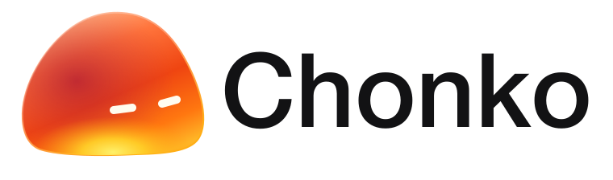

<p align="center"></p>

# Chonko

**Менші файли. Більше місця. Усе на твоєму Mac.**

Chonko — застосунок для локального стиснення зображень, PDF та відео з українським і англійським інтерфейсом. Обирай файли, перевіряй результат і керуй збереженням у одному робочому просторі macOS.

[Завантажити 1.0.0](https://github.com/bohdansii/Chonko/releases/tag/v1.0.0) · [English](README.md) · [Повідомити про проблему](https://github.com/bohdansii/Chonko/issues)

## Встановлення

Потрібен **Mac з Apple Silicon (M1 або новіший), macOS 26 або новіша**. Intel Mac наразі не підтримується.

1. Відкрий [останній реліз](https://github.com/bohdansii/Chonko/releases/latest) і завантаж `Chonko-v1.0.0.dmg`.
2. Відкрий DMG та перетягни **Chonko.app** у **Applications / Програми**.
3. Запусти Chonko з «Програм». Для оновлення спочатку закрий попередню версію.

Це персональна збірка з локальним ad-hoc підписом, **без нотаризації Apple**. macOS може заблокувати завантажену копію. Якщо довіряєш цьому релізу, після спроби запуску відкрий **Системні параметри → Приватність і безпека → Усе одно відкрити**. Не вимикай Gatekeeper для всієї системи. [Інструкція Apple](https://support.apple.com/102445).

Apple Developer, Homebrew і термінал для користування не потрібні; кодеки вже всередині. Хеші файлів — у `SHA256SUMS.txt` біля інсталятора.

## Що вміє

- **Зображення:** WebP, JPEG, PNG, HEIC, TIFF, JPEG 2000 та AVIF, коли системний кодек доступний; якість і підтримувані режими без втрат.
- **PDF:** збереження якості, збалансоване або сильніше стиснення; перевірка сторінок і тексту.
- **Відео:** MP4/MOV/M4V → MP4, HEVC або H.264, сила стиснення та необов’язкова зміна роздільності.
- Вибір окремих файлів чи папок, перетягування, фільтри пошуку, виключення та показ у Finder.
- Прогрес для кожного файла, приблизний час відео, зупинка та пропуск.
- Копії поруч, спільна папка або заміна з переміщенням оригіналів у Кошик після перевірки.
- Статистика, порівняння результату, експорт локального звіту діагностики.
- Нативні елементи macOS, напівпрозорі скляні панелі й анімований персонаж.

## Як почати

Зліва обери **Зображення / PDF / Відео**, потім файли чи папку. Перевір галочки, параметри праворуч і спосіб збереження. Натисни **Оптимізувати** — автоматичної обробки при запуску немає.

Для відео почни з **Швидко → HEVC → Збалансоване**. «Ретельніше» використовує програмний HEVC з одним проходом і потребує більше часу. «Перевірити фрагмент» дає порівняти короткий уривок; «Підібрати стиснення» перевіряє кілька налаштувань на фрагментах, не обробляючи весь файл.

Легке / Збалансоване / Сильне залишають відповідно **70% / 50% / 30% початкового бітрейту відео**. Це кількість даних, **не відсоток якості** й не гарантія кінцевої ваги. Звук теж займає місце. Для PDF і відео початковий спосіб збереження — копія поруч; для зображень — заміна з Кошиком, із підтвердженням.

## Захист файлів і обмеження

Системні ресурси, пакети застосунків, бібліотеки «Фото», приховані папки, символічні та жорсткі посилання пропускаються. «Увесь Mac» шукає доступні особисті файли обраного типу; це не обхід дозволів macOS. Хмарні файли, яких немає локально, не завантажуються автоматично.

Існуючі файли не перезаписуються. Змінений під час обробки оригінал не замінюється. Якщо результат не менший, можна зберегти або відкинути його вручну. Копії поруч і файли у Кошику продовжують займати місце — статистика різниці ваги не дорівнює фактично звільненому диску.

HDR, RAW, анімація та складні непідтримувані зображення пропускаються. Відео: один підтримуваний прогресивний 8-бітний SDR-потік; HDR, Dolby Vision, субтитри й складні доріжки поки не підтримуються. Захищені PDF, підписи та форми пропускаються; складні документи можуть вимагати профілю збереження якості. OCR та AV1 для відео ще немає. Змішані типи файлів обробляються окремими партіями.

Зміна формату змінює розширення й може порушити посилання на файл в інших програмах. Спочатку перевіряй копії важливих файлів. Стиснення з втратами не гарантує відсутності видимих змін.

## Приватність і діагностика

Обробка відбувається **локально**: файли не надсилаються на сервер. Немає акаунта, хмарного завантаження чи автоматичної відправки діагностики.

Якщо виникла проблема, відкрий **Діагностика… → Експортувати звіт…** та прикріпи JSON до issue. Після аварійного закриття спочатку знову відкрий Chonko. Звіт містить версію, параметри системи, етапи задач, очищені повідомлення кодеків і до 200 технічних подій. Назви та шляхи оригіналів не додаються. Перед публікацією власного скриншота перевір, чи немає на ньому приватних файлів.

## Розробка

Swift 6, SwiftUI, AppKit, Swift Charts, ImageIO, PDFKit та AVKit; ціль — macOS 26+.

```sh
git clone https://github.com/bohdansii/Chonko.git
cd Chonko
swift test --disable-sandbox
bash build-app.sh
```

Потрібні сумісні Xcode / Command Line Tools зі Swift 6.2+ та SDK macOS 26+. Тести створюють синтетичні файли. Бінарні інструменти ARM64 вже в `Resources/Codecs`; `python3 scripts/build-media-tools.py` відтворює медіаінструменти з перевірених джерел і отримує закріплений офіційний WebP-пакет Google. Ця команда потребує мережі та займає час.

Збірка створює DMG/ZIP у `releases/`, підписуючи застосунок у тимчасовій папці. Для випуску без Developer ID нотаризація не виконується. Деталі залежностей — [THIRD_PARTY_NOTICES.md](THIRD_PARTY_NOTICES.md).

## Авторські права

© 2026 Bohdan — [@bohdansii](https://github.com/bohdansii). Власний код і брендинг Chonko **поки не мають відкритої ліцензії**. Публічність репозиторію не є дозволом повторно використовувати чи поширювати їх. Див. [LICENSE](LICENSE).

Незалежні сторонні компоненти залишаються під власними ліцензіями; ці права не обмежуються повідомленням Chonko. Вихідні коди кодеків і необхідні повідомлення доступні разом із релізом.
